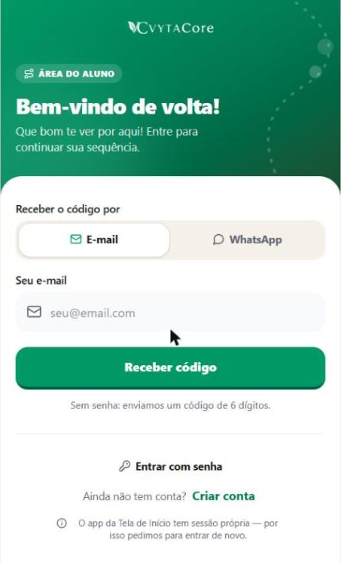
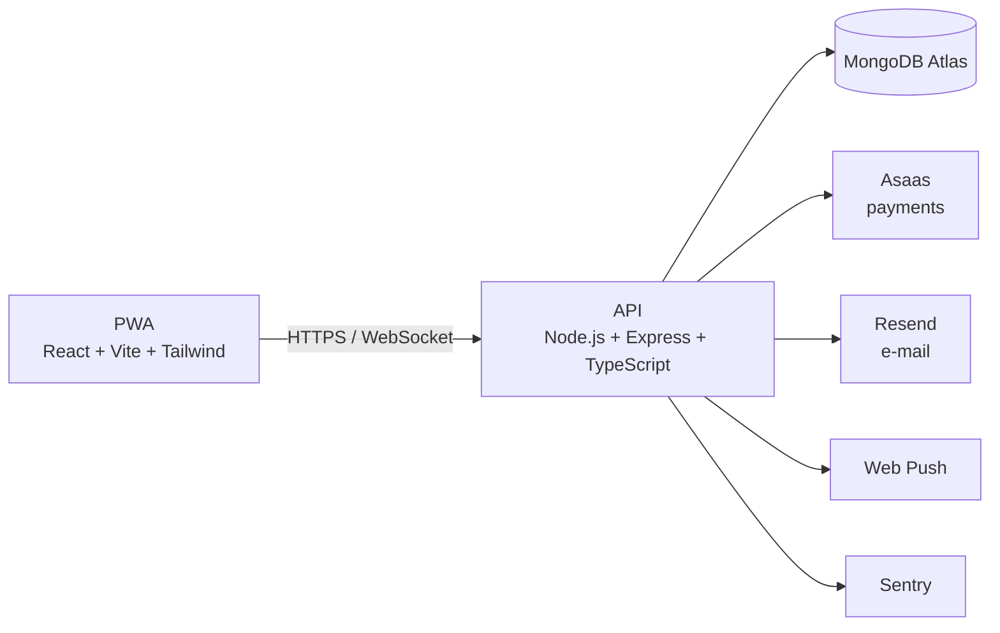

<h1 align="center">VYTACore App</h1>

Client ↔ specialist follow-up platform with Duolingo-style gamification

      

<a href="https://app.vytacore.com.br"><b>Live app</b></a>

> **Note:** the source code is private (production systems). This repository is a technical overview: what it does, how it is built and what it looks like. Happy to walk through the code in an interview — reach me on [LinkedIn](https://www.linkedin.com/in/guilherme-vytacore/).

## Overview

A Progressive Web App that connects clients with specialists and keeps clients engaged through a gamified retention layer: daily path, streaks, XP, weekly leagues, missions, pairs and a coin shop. Live at [app.vytacore.com.br](https://app.vytacore.com.br).

## Highlights

- **Real-time chat** between client and specialist (Socket.io)
- **Gamification engine** with an idempotent XP ledger, leagues, missions, achievements and streaks
- **Recurring payments** with Asaas, idempotent webhooks and dunning
- **Push notifications** (Web Push / VAPID) and transactional e-mail (Resend)
- **Security and LGPD compliance**: httpOnly JWT cookies, Zod validation, Helmet, rate limiting, community moderation, account deletion and encryption at rest
- **Specialist area** with wallet, billing, reviews and student management
- **End-to-end tests** covering gamification, multi-specialist scoping, concurrency and sockets
- Passwordless sign-in with one-time codes by e-mail or WhatsApp

## Architecture

## By the numbers

| Metric | Value |
|---|---|
| REST endpoints | 70+ |
| Screens (client + specialist) | 76 |
| Reusable components | 64 |
| Lines of code | ~35k |

## Tech stack

- **Frontend:** React, TypeScript, Vite, Tailwind CSS, Radix / shadcn/ui, TanStack Query, PWA
- **Backend:** Node.js, Express, TypeScript, Mongoose, Socket.io, Zod, JWT
- **Infrastructure:** Render, MongoDB Atlas, Cloudflare, Sentry

---

<b>Versão em português</b>

> **Observação:** o código-fonte é privado (sistemas em produção). Este repositório é uma visão técnica do projeto. Posso apresentar o código em uma entrevista — fale comigo pelo [LinkedIn](https://www.linkedin.com/in/guilherme-vytacore/).

## Visão geral

Web app (PWA) que conecta clientes a especialistas e mantém o cliente engajado com uma camada de retenção gamificada: trilha diária, sequência, XP, ligas semanais, missões, duplas e loja de moedas. No ar em [app.vytacore.com.br](https://app.vytacore.com.br).

## Destaques

- **Chat em tempo real** entre cliente e especialista (Socket.io)
- **Motor de gamificação** com ledger de XP idempotente, ligas, missões, conquistas e ofensiva
- **Pagamentos recorrentes** com Asaas, webhooks idempotentes e controle de pendências
- **Notificações push** (Web Push / VAPID) e e-mails transacionais (Resend)
- **Segurança e LGPD**: JWT em cookie httpOnly, validação com Zod, Helmet, rate limit, moderação, exclusão de conta e criptografia em repouso
- **Área do profissional** com carteira, faturamento, revisões e gestão de alunos
- **Testes e2e** de gamificação, multi-especialista, concorrência e sockets
- Login sem senha com código por e-mail ou WhatsApp

## Stack

- **Frontend:** React, TypeScript, Vite, Tailwind CSS, Radix / shadcn/ui, TanStack Query, PWA
- **Backend:** Node.js, Express, TypeScript, Mongoose, Socket.io, Zod, JWT
- **Infra:** Render, MongoDB Atlas, Cloudflare, Sentry

